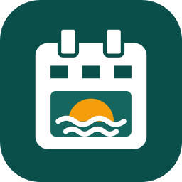
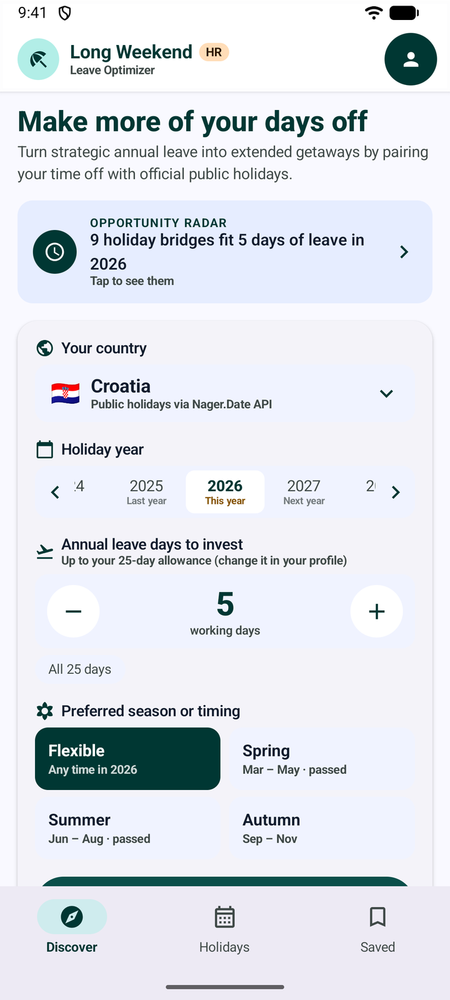
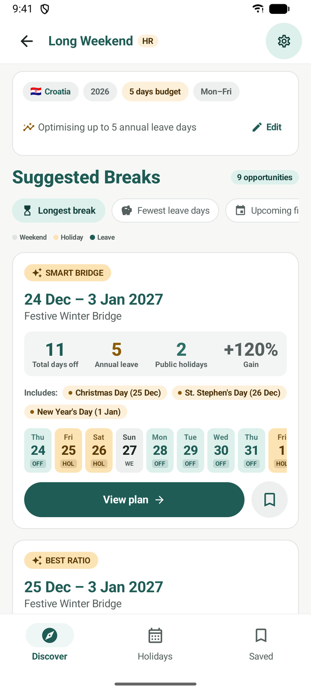
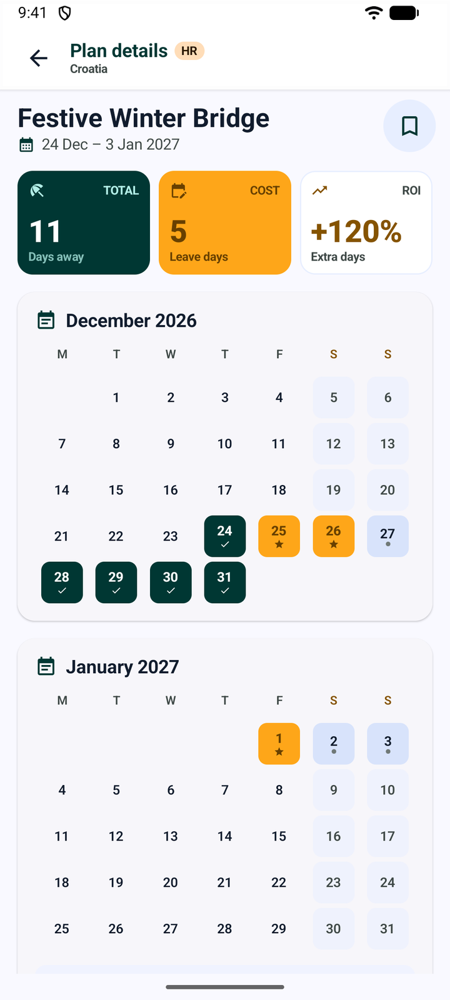
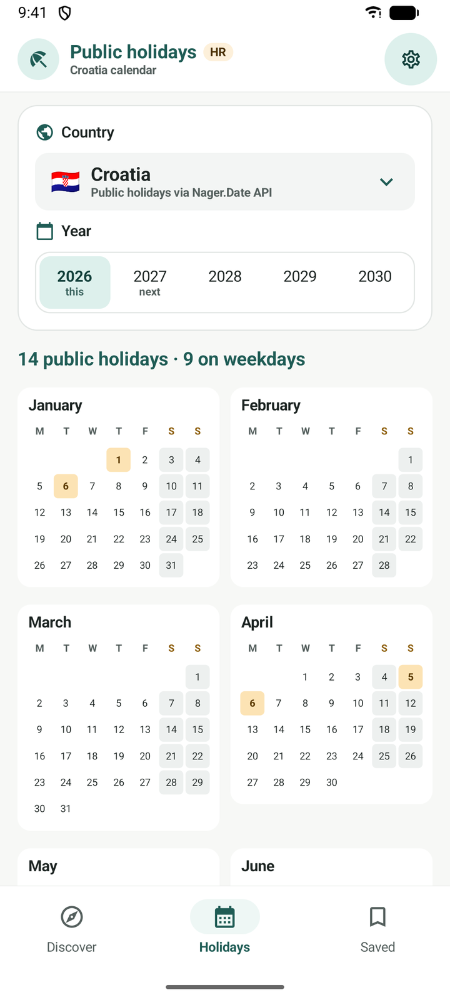
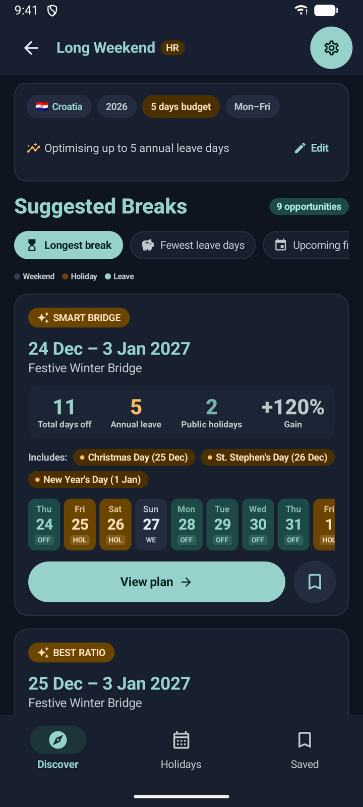
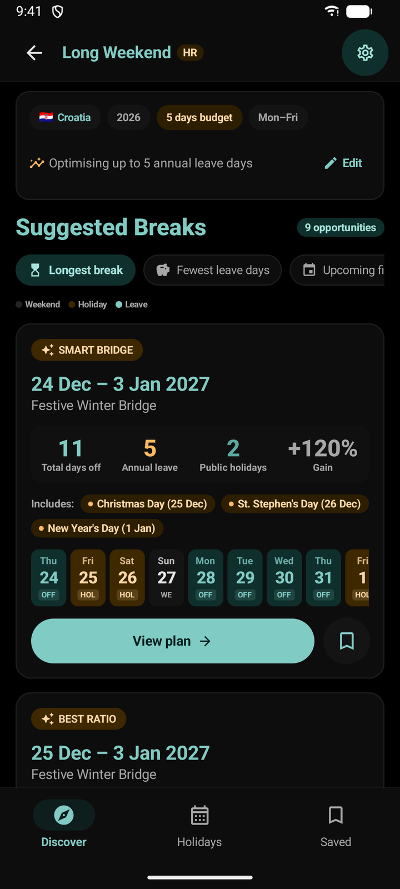

<p align="center">
  
</p>

<h1 align="center">Long Weekend</h1>

<p align="center">
  <b>Turn a few days of annual leave into long breaks.</b><br>
  A free, open-source Android planner that finds every public-holiday bridge for 204 countries.
</p>

<p align="center">
  <a href="https://github.com/mgracanin/long-weekend-finder/releases/latest"></a>
</p>

<p align="center">
  <a href="https://github.com/mgracanin/long-weekend-finder/actions/workflows/ci.yml"></a>
  
  
  <a href="LICENSE"></a>
  <a href="PRIVACY.md"></a>
</p>

<p align="center">
  
  
  
  
</p>

---

## Take 5, get 11

Public holidays rarely fall where you need them. Long Weekend looks at every holiday in your country and works out exactly which working days to book so they join up with weekends into one long break.

Croatia, Christmas 2026: book **5 days** of leave and you are off for **11 days in a row**.

| Thu 24 | Fri 25 | Sat 26 | Sun 27 | Mon 28 | Tue 29 | Wed 30 | Thu 31 | Fri 1 | Sat 2 | Sun 3 |
|:---:|:---:|:---:|:---:|:---:|:---:|:---:|:---:|:---:|:---:|:---:|
| 🟩 | 🟧 | 🟧 | ⬜ | 🟩 | 🟩 | 🟩 | 🟩 | 🟧 | ⬜ | ⬜ |

🟩 annual leave &nbsp;·&nbsp; 🟧 public holiday &nbsp;·&nbsp; ⬜ weekend

St Stephen's Day falls on a Saturday that year, so the app counts only the two weekday holidays as saving leave: 5 leave + 2 holidays + 4 weekend days = 11.

## Features

- 🧭 **Discover**: pick a country, a year and how many leave days you want to spend, and see the best bridges straight away.
- 📋 **Suggested breaks**: every useful combination, sorted by longest break, fewest leave days or soonest date, with a day-by-day strip and how many extra days you gain.
- 🗓️ **Plan details**: month calendars, the exact dates to request from HR with a checklist, copy to clipboard and add to Google Calendar.
- 📤 **Share a plan** from Plan details or Saved, by e-mail, WhatsApp, Viber or any other app: the dates to request, the holidays and what you gain, as readable text.
- 🌍 **Public holidays**: the whole year at a glance for 204 countries, national and regional.
- 🔖 **Saved plans**: keep the breaks you like and tick off each day as your employer approves it.
- 📄 **Year report (PDF)**: all saved breaks for a year in one document, with leave used against your allowance, a year calendar and warnings for overlaps or overspending. Share it, save it or print it.
- 🗂️ **Your working week**: Monday–Friday or Sunday–Thursday, set from your country automatically.
- 🌗 **Light, dark and black (OLED) themes**: follows your phone, or pick one yourself.
- 🇬🇧 🇭🇷 **English and Croatian**, switchable in the app.
- ✈️ **Works offline** with built-in calendars for 10 countries (HR, GB, DE, FR, IT, ES, US, CA, AU, IE).

## Three themes

The black theme is made for OLED and AMOLED screens: the page is pure black, so those pixels are switched off and use no power. Cards stay near-black and holiday blocks use deep colours.

<p align="center">
  
  
  
</p>
<p align="center"><sub>Light &nbsp;·&nbsp; Dark &nbsp;·&nbsp; Black (OLED battery saver)</sub></p>

## Install

1. Download **`long-weekend-<version>.apk`** from the [latest release](https://github.com/mgracanin/long-weekend-finder/releases/latest) on your phone.
2. Open it. If Android asks, allow your browser or file manager to install apps.
3. Done. Updates install over the top and keep your saved plans.

Requires Android 8.0 or newer.

<a href="https://apps.obtainium.imranr.dev/redirect?r=obtainium://add/https://github.com/mgracanin/long-weekend-finder"></a>

Use [Obtainium](https://github.com/ImranR98/Obtainium) to get new versions automatically.

<details>
<summary>Check the download (optional)</summary>

Every release lists the APK's SHA-256 checksum. Release APKs are signed with this certificate:

```
SHA-256: EF:53:45:72:EF:2B:29:44:06:42:15:A2:C9:71:B8:C0:64:03:68:C4:15:A5:E1:91:7B:DD:08:C5:E7:E5:6D:92
```

Check it with `apksigner verify --print-certs long-weekend-<version>.apk`.
</details>

## Privacy

No account, no ads, no analytics, no tracking. Your settings and saved plans are stored only on your phone (and in your own Google backup, if you have it turned on). The app only goes online to fetch public holidays from [Nager.Date](https://date.nager.at). Details are in [PRIVACY.md](PRIVACY.md).

## How it works

Holidays come from the free [Nager.Date](https://date.nager.at) public holidays API, cached on the phone. For every holiday the optimizer tries each window around it. It keeps breaks that:

- start and end next to working days,
- need at least one leave day, within your budget,
- include a holiday that falls on a working day.

A holiday on a weekend is still shown in the break, but it isn't counted as saving leave, because that day was off anyway.

It then drops any break that an overlapping one beats on both leave cost and length. The bridge-finding code is in [`HolidayBridgeOptimizer.kt`](app/src/main/java/com/longweekend/optimizer/optimizer/HolidayBridgeOptimizer.kt) and is covered by unit tests.

## Build from source

You need JDK 17+ and the Android SDK (platform 36). The easiest way is to open the project in Android Studio. From the command line, create `local.properties` with `sdk.dir=/path/to/Android/Sdk`, then:

```bash
./gradlew testDebugUnitTest   # unit tests
./gradlew installDebug        # build and install on a connected phone or emulator
```

<details>
<summary>Release builds and signing</summary>

Release builds are minified with R8, ship a baseline profile and are signed with a key read from `keystore.properties` in the project root. That file is git-ignored; never commit it.

```properties
storeFile=your-release-key.jks
storePassword=...
keyAlias=...
keyPassword=...
```

```bash
./gradlew assembleRelease     # app/build/outputs/apk/release/app-release.apk
./gradlew bundleRelease       # app/build/outputs/bundle/release/app-release.aab (Google Play)
```

To try a release build without your own key, add `-PsignReleaseWithDebug`. Google Play won't accept a build signed that way.

**Publishing a release.** Pushing a `v*` tag runs the [release workflow](.github/workflows/release.yml). It builds and signs the APK and attaches it to a GitHub release. It needs four repository secrets:

- `KEYSTORE_BASE64`: the `.jks` file, base64-encoded
- `KEYSTORE_PASSWORD`
- `KEY_ALIAS`
- `KEY_PASSWORD`

If you publish a fork, change `applicationId` in `app/build.gradle.kts` and the links in `AppLinks.kt`, and sign it with your own key.
</details>

## Under the hood

Kotlin · Jetpack Compose with Material 3 · MVVM with StateFlow · Retrofit + Gson · lazy lists and Compose strong skipping for smooth scrolling · R8 + baseline profile · `minSdk 26`, `targetSdk 36`

```
app/src/main/java/com/longweekend/optimizer/
├── model/        data classes, countries, working weeks
├── optimizer/    HolidayBridgeOptimizer: the bridge-finding algorithm
├── repository/   holiday API, cache, offline calendars, settings, saved plans
├── viewmodel/    MainViewModel
└── ui/           Compose screens, components, themes, plan sharing and text formatting
```

## Contributing

Issues and pull requests are welcome. Please run `./gradlew testDebugUnitTest` before opening a pull request.

**Translations** are the easiest way to help:

1. Copy `app/src/main/res/values/strings.xml` to `values-<language code>/strings.xml` and translate it.
2. Add the language to `LANGUAGES` in `ProfileScreen.kt`.
3. Open a pull request.

## Licence

[MIT](LICENSE). Public holiday data © [Nager.Date](https://date.nager.at) (MIT).
